# Tugas Web Programming - P11 E-Commerce DB + Secure Auth

## Identitas

- **Nama:** Rafli Arrahman
- **Program Studi:** Ilmu Komputer
- **Mata Kuliah:** Pemrograman Web
- **Tugas:** Tugas Rutin 11 - E-Commerce DB + Secure Auth

## Deskripsi

Proyek ini merupakan aplikasi e-commerce sederhana berbasis Laravel dan MySQL yang dikembangkan untuk memenuhi Tugas Rutin 11 pada mata kuliah Pemrograman Web.

Proyek ini berfokus pada pengelolaan database, relasi antarmodel menggunakan Eloquent ORM, autentikasi pengguna, pembatasan akses berdasarkan role, serta otorisasi tindakan terhadap produk menggunakan ProductPolicy.

## Teknologi yang Digunakan

- PHP 8.3.33
- Laravel 13.34.0
- MySQL
- Composer
- Node.js dan npm
- Laragon
- phpMyAdmin
- Laravel Breeze
- Visual Studio Code

## Fitur Aplikasi

1. Autentikasi pengguna menggunakan Laravel Breeze, meliputi login, registrasi, dan logout.
2. Pengelolaan data kategori, produk, pesanan, dan item pesanan melalui model Eloquent.
3. Relasi antarmodel untuk menghubungkan data produk, kategori, pengguna, dan pesanan.
4. Pembatasan akses halaman berdasarkan role admin, editor, dan user menggunakan middleware.
5. Otorisasi tindakan edit dan hapus produk menggunakan ProductPolicy.
6. Pengujian query database menggunakan Laravel Tinker.

## Struktur Database

Database yang digunakan dalam proyek ini adalah `tugasweb_p11_ecommerce`.

Tabel utama yang digunakan meliputi:

- `users`
- `categories`
- `products`
- `orders`
- `order_items`
- `tags`
- `product_tag`

Proyek ini juga menggunakan tabel pendukung Laravel sesuai dengan migrasi yang tersedia, seperti tabel cache dan jobs.

## Persyaratan Sistem

Sebelum menjalankan proyek, pastikan perangkat telah memiliki:

- PHP yang kompatibel dengan proyek.
- Composer.
- MySQL atau MariaDB.
- Node.js dan npm.
- Laragon atau lingkungan pengembangan PHP sejenis.

## Instalasi dan Konfigurasi

### 1. Clone Repository

```bash
git clone https://github.com/USERNAME/TugasWeb-P11-EcommerceAuth.git
cd TugasWeb-P11-EcommerceAuth
```

Ganti `USERNAME` dengan username GitHub pemilik repositori.

### 2. Instal Dependensi

```bash
composer install
npm install
```

### 3. Siapkan File Environment

Buat file `.env` berdasarkan templat `.env.example`:

```bash
copy .env.example .env
```

Kemudian buat application key:

```bash
php artisan key:generate
```

### 4. Konfigurasi Database

Buat database bernama `tugasweb_p11_ecommerce` melalui phpMyAdmin atau MySQL.

Sesuaikan konfigurasi database di file `.env`:

```env
DB_CONNECTION=mysql
DB_HOST=127.0.0.1
DB_PORT=3306
DB_DATABASE=tugasweb_p11_ecommerce
DB_USERNAME=root
DB_PASSWORD=
```

Sesuaikan username dan password dengan konfigurasi MySQL lokal yang digunakan.

### 5. Jalankan Migrasi dan Seeder

Pastikan database yang dipilih adalah database khusus proyek P11 dan periksa kondisi data sebelum menjalankan migrasi atau seeder.

Untuk instalasi baru:

```bash
php artisan migrate --seed
```

Perintah tersebut menjalankan migrasi dan seeder yang terdaftar dalam konfigurasi proyek. Jika database sudah berisi data, periksa terlebih dahulu agar tidak mengulang proses yang tidak diperlukan.

### 6. Jalankan Aplikasi

Jalankan server Laravel di terminal pertama:

```bash
php artisan serve
```

Jalankan Vite di terminal kedua:

```bash
npm run dev
```

Buka alamat lokal yang ditampilkan oleh Laravel Artisan di browser.

## Pengujian

Pengujian proyek mencakup beberapa aspek berikut:

1. Memeriksa struktur database dan data produk.
2. Menghitung jumlah produk menggunakan Laravel Tinker.
3. Memeriksa relasi produk dengan kategori.
4. Memeriksa relasi pengguna dengan pesanan.
5. Menghitung total pesanan berdasarkan item pesanan.
6. Memfilter produk berdasarkan kategori Elektronik.
7. Menguji halaman login Laravel Breeze.
8. Menguji middleware role untuk admin dan user.
9. Menguji ProductPolicy terhadap akses edit produk.
10. Memastikan pengguna tanpa izin mendapatkan respons akses ditolak.

## Dokumentasi Pengujian

Bukti pengujian disimpan di folder [`docs/`](docs/).

## Dokumentasi Pengujian

Seluruh bukti pengujian disimpan dalam folder `docs/`.

### A. Database dan Query Laravel Tinker

**1. Struktur Database P11**

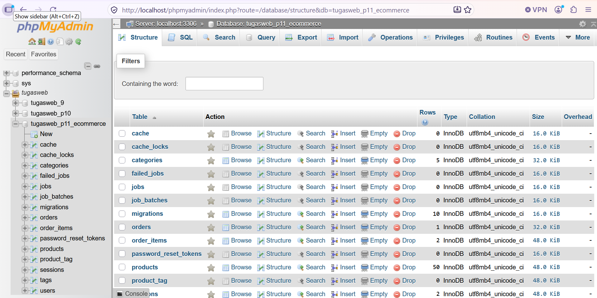

**2. Data Produk**

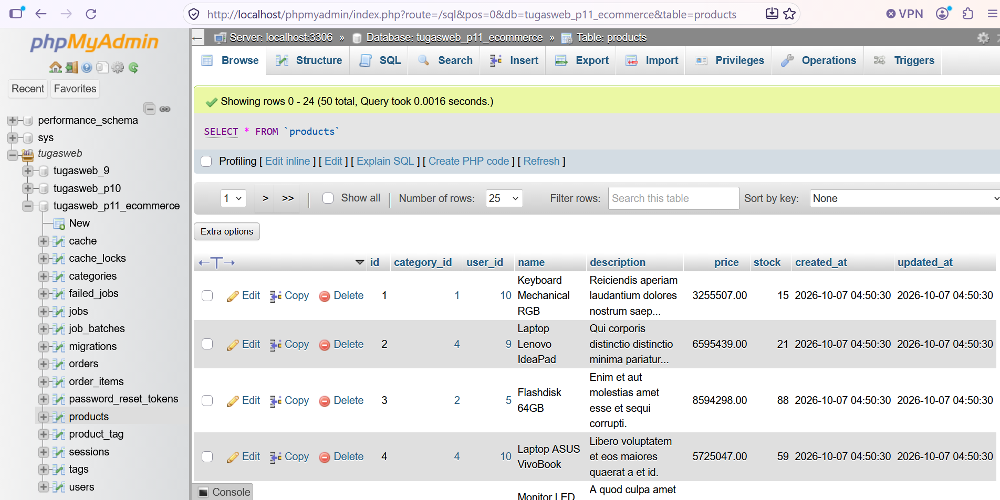

**3. Query 1 — Jumlah Produk**

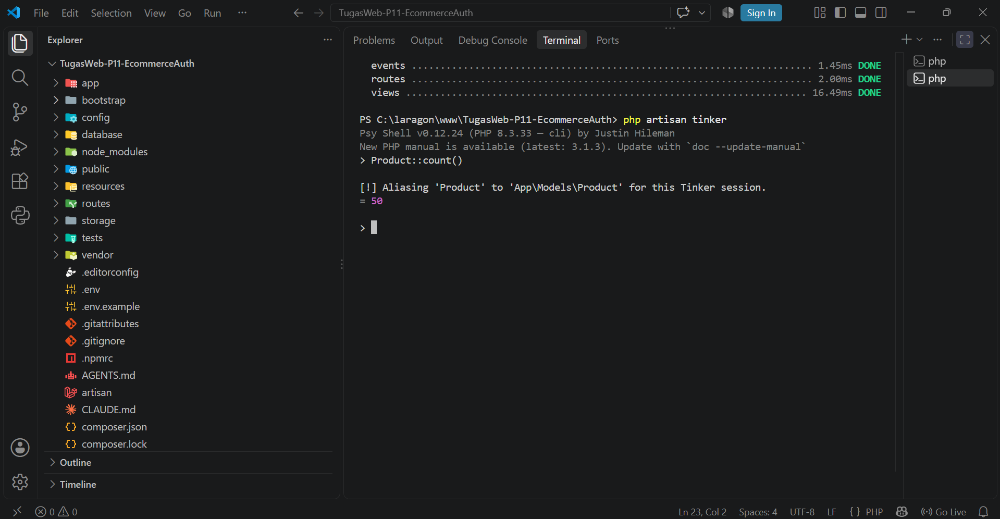

**4. Query 2 — Relasi Produk dan Kategori**

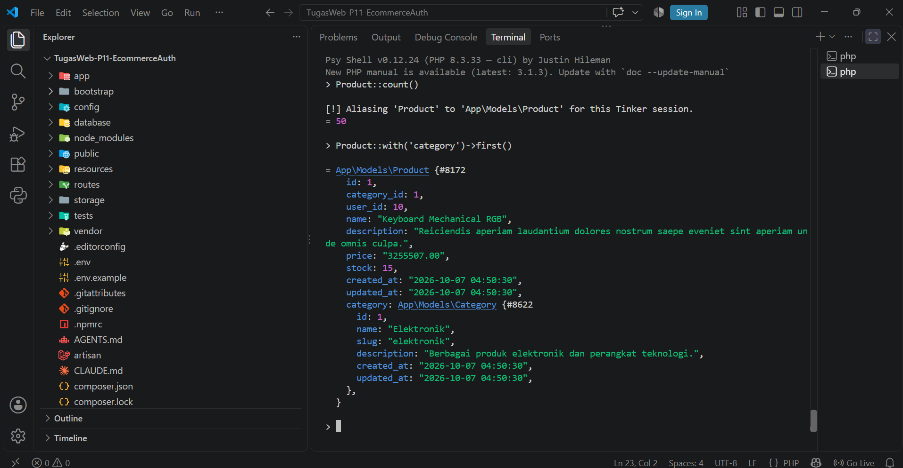

**5. Query 3 — Jumlah Pesanan**

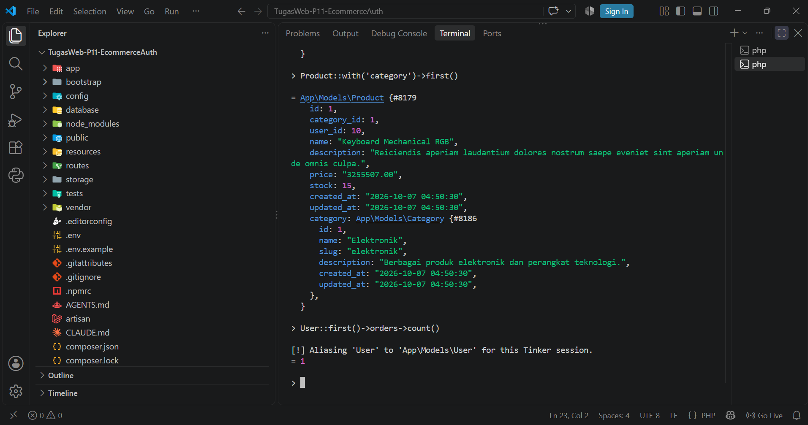

**6. Query 4 — Total Pesanan**

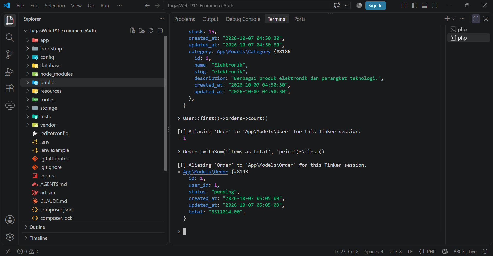

**7. Query 5 — Filter Kategori Elektronik**

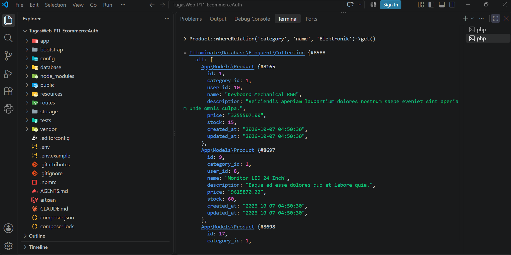

### B. Autentikasi dan Otorisasi

**8. Halaman Login Laravel Breeze**

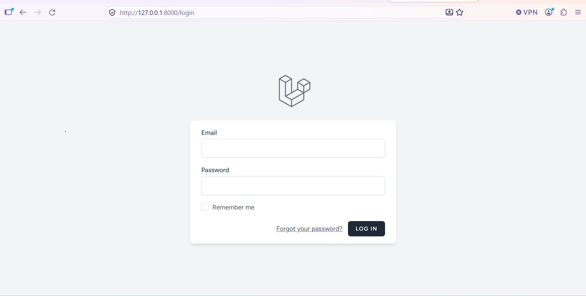

**9. Role Admin — Akses Berhasil**

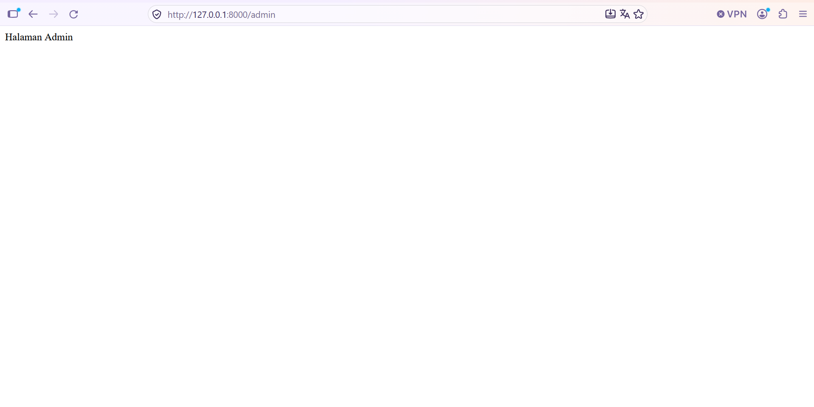

**10. Role User — Akses Admin Ditolak**

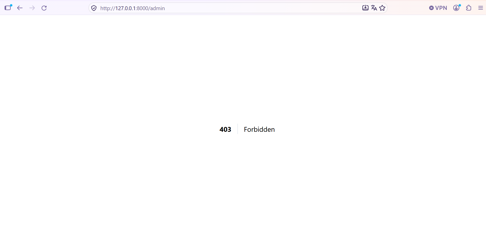

**11. ProductPolicy — Akses Edit oleh User Ditolak**

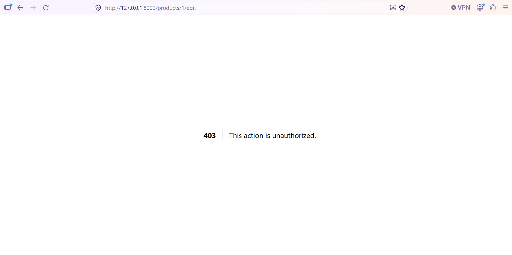

**12. ProductPolicy — Akses Edit oleh Admin Diizinkan**

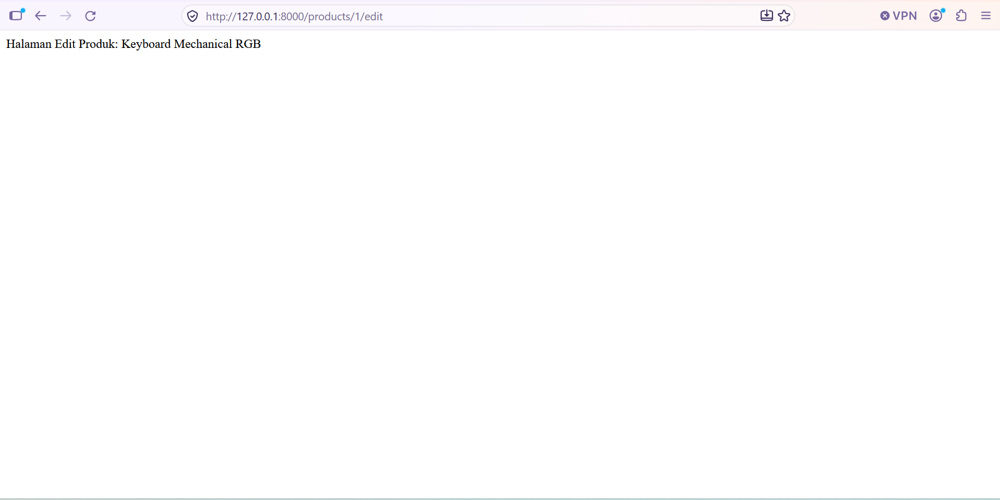

Pastikan seluruh file screenshot di atas benar-benar tersedia di folder `docs/`. Nama file pada tabel harus sesuai dengan nama file yang diunggah.

## Keamanan

- File `.env` tidak disertakan dalam repository karena dapat berisi konfigurasi lokal dan informasi sensitif.
- File `.env.example` digunakan sebagai templat konfigurasi.
- Folder `vendor` dan `node_modules` tidak perlu diunggah karena dependensi dapat dipasang kembali menggunakan Composer dan npm.

## Penutup

Proyek ini menjadi penerapan konsep pengembangan aplikasi web menggunakan Laravel, pengelolaan database relasional, autentikasi, middleware, dan otorisasi berbasis kebijakan akses.

Seluruh fitur dan pengujian didokumentasikan sebagai bukti pengerjaan Tugas Rutin 11 pada mata kuliah Pemrograman Web.